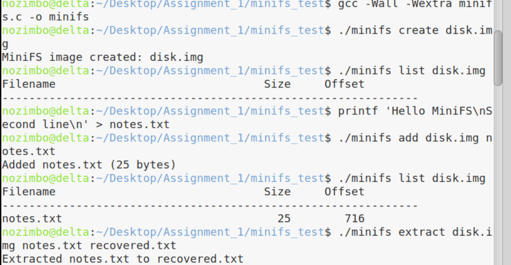
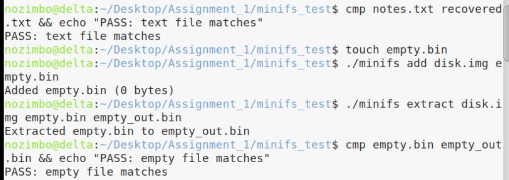
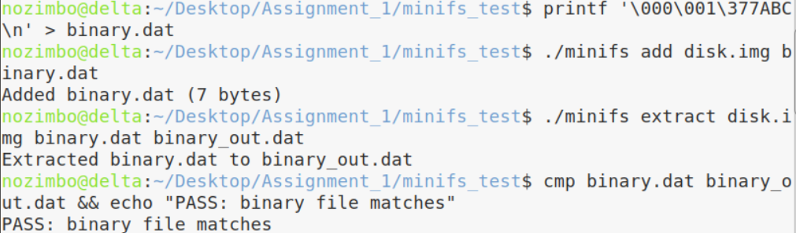
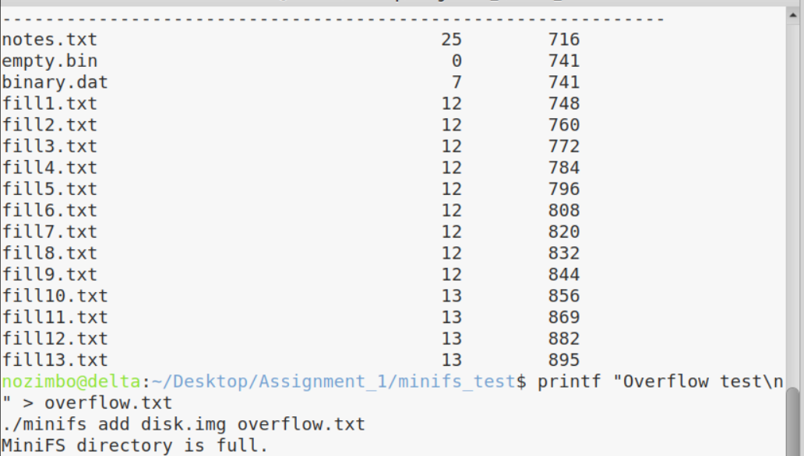

# MiniFS Assignment 01

## Compilation

Compile the program using:

```bash
gcc -Wall -Wextra minifs.c -o minifs
```

## Usage Examples

### 1. Create a MiniFS image
```bash
./minifs create disk.img
```

### 2. Add a file
```bash
./minifs add disk.img notes.txt
```

### 3. List stored files
```bash
./minifs list disk.img
```

### 4. Extract a file
```bash
./minifs extract disk.img notes.txt recovered.txt
```

### 5. Verify the extracted file
```bash
cmp notes.txt recovered.txt
```

If cmp produces no output, the files match.


## Testing Results

### Text File Test
The file was added, extracted, and compared successfully.



### Empty File Test
Empty files were added and extracted successfully.



### Binary File Test
The extracted binary file matched the original.



### Directory Limit Test
MiniFS rejected an attempt to add a seventeenth file.

